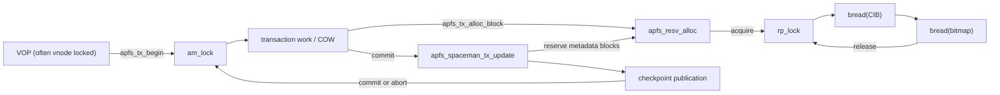

# Locking and stalled-operation diagnosis

## Locks and blocking operations

The relevant locks are distinct:

- `am_lock` serializes APFS transactions. `apfs_tx_begin()` acquires it;
  successful commit and transaction abort release it.
- `rp_lock` protects the in-memory block-reservation list and allocation cursor.
  `apfs_resv_alloc()` currently holds it while reading CIB and bitmap buffers.
- `bread()` can wait for the device and for a busy buffer. Its call sites are
  potential wait points, not just metadata parsing. The APFS `bread()`,
  `getblk()`, and `bwrite()` wrappers log before and after the underlying
  buffer-cache operation.
- VOP calls can also arrive with vnode locks held; transaction serialization
  does not replace vnode locking.

The order in the diagram is a wait-risk map, not proof of a lock cycle. In
particular, `rp_lock` is held across CIB and bitmap reads in
`apfs_resv_alloc()`. Any other path that holds a buffer needed by those reads
while waiting for `rp_lock` could form a cycle. Similarly, a thread waiting for
`am_lock` can be a victim of an earlier transaction stuck in I/O. The
`apfs_trace:` messages bracket these waits so a captured console log can
establish which one actually stalls.

`apfs_spaceman_tx_update()` copies the Space Manager object and releases its
buffer before requesting allocations; it likewise copies and releases a CIB
before allocating replacement metadata. This avoids recursively reading a
buffer held by that same update operation. Keep these buffer-release boundaries
when modifying the allocation loop.

## Reading the trace

The trace calls are enabled by default for ongoing development. Capture kernel
console output on a serial console or another persistent console if possible;
SSH may be unavailable when the kernel is stuck. The last message identifies
the boundary not crossed:

| Last trace | Likely wait/stop boundary |
|---|---|
| `tx_begin wait am_lock` | Acquiring the transaction mutex; look for the current lock owner and its transaction's last trace. |
| `resv_alloc wait rp_lock` | Acquiring the reservation mutex; look for a thread holding it. |
| `tx_commit ... wait rp_lock cleanup` | Acquiring the reservation mutex while commit drops the transaction's reservations. |
| `getblk wait paddr=...` without matching `getblk return` | Waiting to obtain a buffer for that physical block. |
| `bread wait paddr=...` without matching `bread return` | Waiting in the buffer cache/device read for that physical block. The preceding allocator trace identifies a CIB or bitmap. |
| `bwrite begin paddr=...` without matching `bwrite return` | Waiting for the buffer-cache/device write to complete. |
| `resv_alloc read CIB` or `read bitmap` without the corresponding bread result | The specific allocation metadata read being attempted. Match the physical address to the generic bread trace. |
| `tx_alloc ... begin` without a result | Stalled inside reservation allocation; the last nested `resv_alloc` trace narrows it. |
| `tx_commit ... stage superblock begin` without `spaceman_update` | Superblock staging or an allocation it triggers. |
| `spaceman_update ... begin` without completion | Space Manager update, metadata allocation, or a metadata write. |
| `checkpoint map write ... begin` or `container superblock write ... begin` without a result | Checkpoint publication write; the nested `bwrite` trace gives its physical block. |
| `tx_commit ... complete; release am_lock` | Commit finished; if the syscall still hangs, investigate VOP/vnode/vcache handling after commit. |

Match `xid` values to correlate transaction messages. Always capture all CPU
stacks (or the kernel debugger's lock/owner reports), not just the user process
state. A machine-wide stall also warrants checking device I/O and unrelated
kernel threads; an APFS trace alone cannot establish that an APFS mutex caused
a whole-machine freeze.

## Test boundary

The `tests/fs/apfs/t_spaceman` harness can write APFS metadata directly to an
image and independently validate the resulting Space Manager structures. It
does not use NetBSD `bread()`, vnode locks, or kernel mutexes, so it cannot
reproduce the kernel buffer-cache deadlock. Kernel VFS tests such as
`tests/fs/apfs/t_vfs_rw` exercise those paths when run under a NetBSD test
environment.
