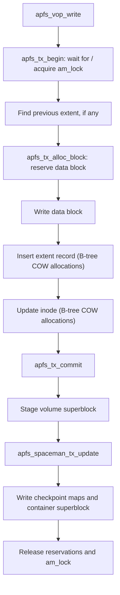

# APFS create and write paths

## Empty-file creation

`touch something.txt` on a nonexistent path requests a name lookup with
`CREATE`, then creates an inode and directory record. It does not need to
allocate a file-data extent for the empty file. It does allocate physical
blocks for copy-on-write B-tree metadata and checkpoint/Space Manager metadata.

```mermaid
sequenceDiagram
    participant U as namei / open(O_CREAT)
    participant V as apfs_vop_lookup
    participant D as apfs_btree_search
    participant C as apfs_vop_create
    participant F as apfs_create_file
    participant T as transaction
    participant B as B-tree / OMap COW
    participant S as Space Manager
    participant K as checkpoint ring

    U->>V: lookup "something.txt", CREATE
    V->>D: search directory record
    D-->>V: ENOENT
    V-->>U: EJUSTRETURN for final create component
    U->>C: VOP_CREATE
    C->>F: create inode + directory record
    F->>T: apfs_tx_begin (takes am_lock)
    F->>B: insert inode record
    B->>S: apfs_tx_alloc_block for COW nodes
    F->>B: insert directory record
    B->>S: apfs_tx_alloc_block for COW nodes
    F->>T: apfs_tx_commit
    T->>S: update bitmap, CIB, and Space Manager mappings
    T->>K: write checkpoint map and container superblock
    T-->>C: commit complete; release am_lock
    C-->>U: vcache_get new inode
```

In the current implementation, `apfs_tx_begin()` serializes mutations with
`amp->am_lock`. `apfs_tx_alloc_block()` delegates to
`apfs_resv_alloc()`, which searches the Space Manager bitmap and records a
reservation. Commit turns those reservations into copy-on-write bitmap/CIB/
Space Manager objects and publishes their mappings in the checkpoint ring.

## Non-empty file write

Writing data follows `apfs_vop_write()`. It allocates a data block, writes it,
inserts an extent record through B-tree COW, updates the inode, and commits the
metadata transaction. The trace prefix `apfs_trace:` includes separate
`vop_write` and `tx_alloc` events to distinguish data-block allocation from
metadata allocation.



## Relevant implementation

| Responsibility | Entry point |
|---|---|
| Name lookup and missing-final-component handling | `sys/fs/apfs/apfs_vnops.c:apfs_vop_lookup` |
| VOP file creation | `sys/fs/apfs/apfs_vnops.c:apfs_vop_create` |
| VOP data writes | `sys/fs/apfs/apfs_vnops.c:apfs_vop_write` |
| Inode and directory-record creation | `sys/fs/apfs/apfs_subr.c:apfs_create_file` |
| Transaction serialization and block reservation | `sys/fs/apfs/apfs_subr.c:apfs_tx_begin`, `apfs_tx_alloc_block`, `apfs_resv_alloc` |
| COW Space Manager metadata | `sys/fs/apfs/apfs_subr.c:apfs_spaceman_tx_update` |
| Checkpoint publication | `sys/fs/apfs/apfs_subr.c:apfs_tx_commit` |
